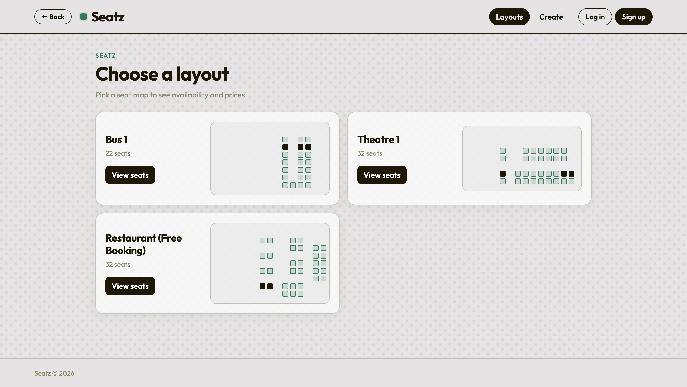
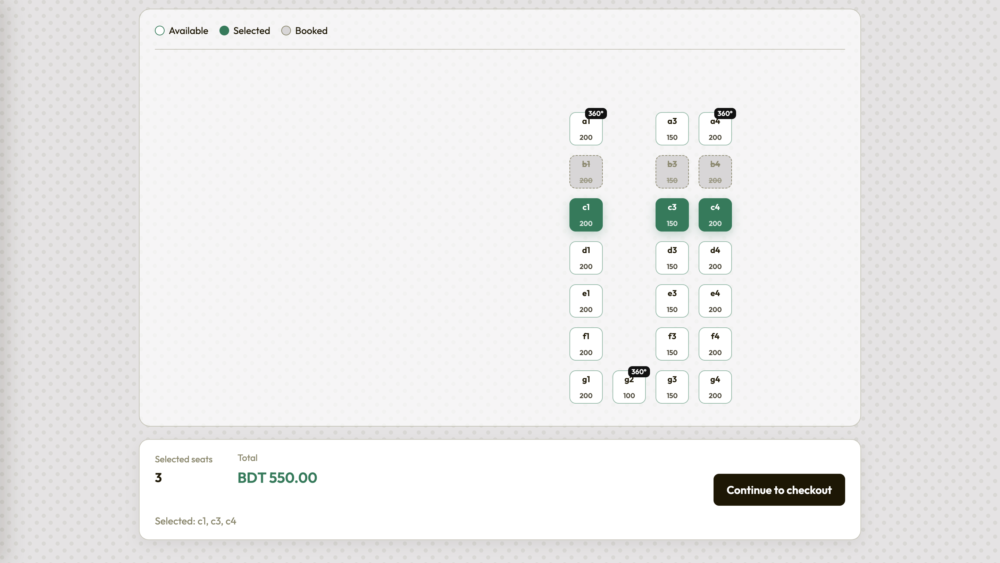
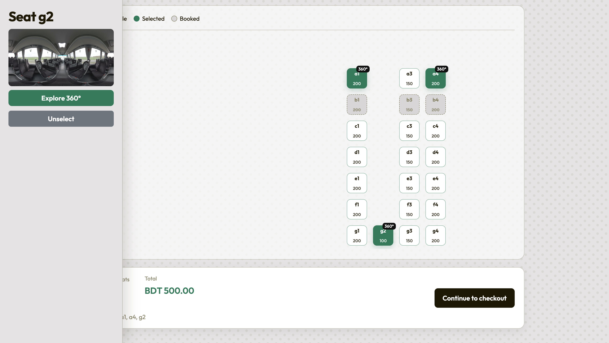
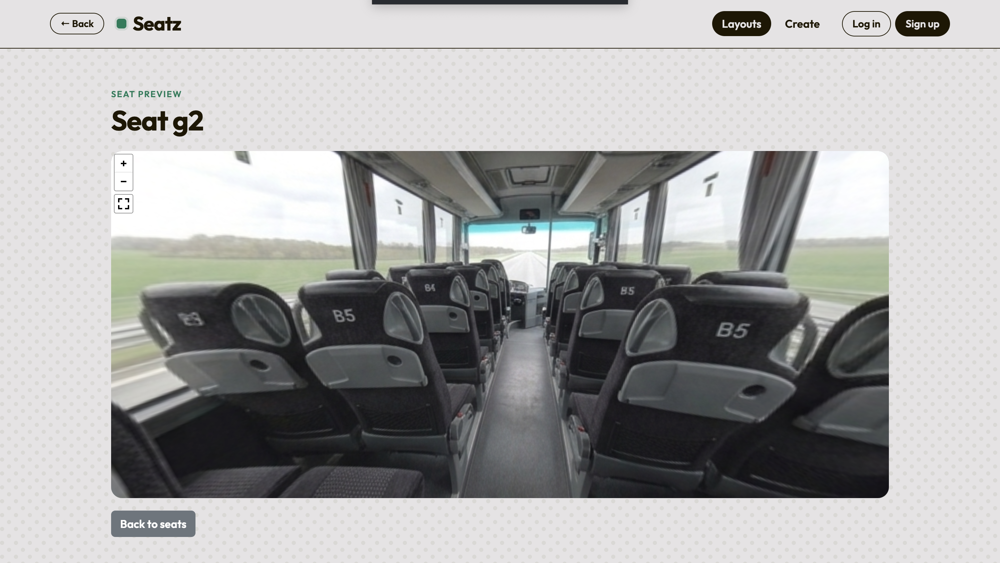
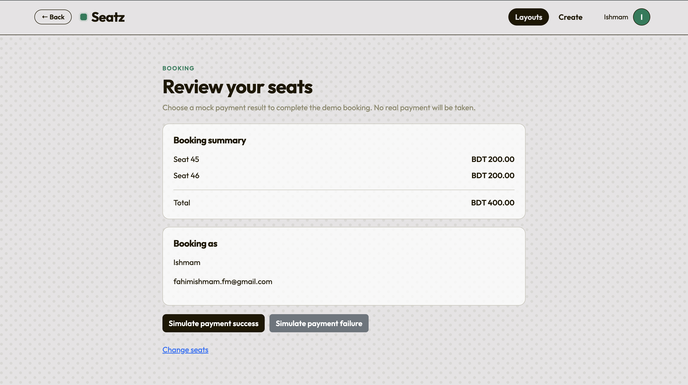
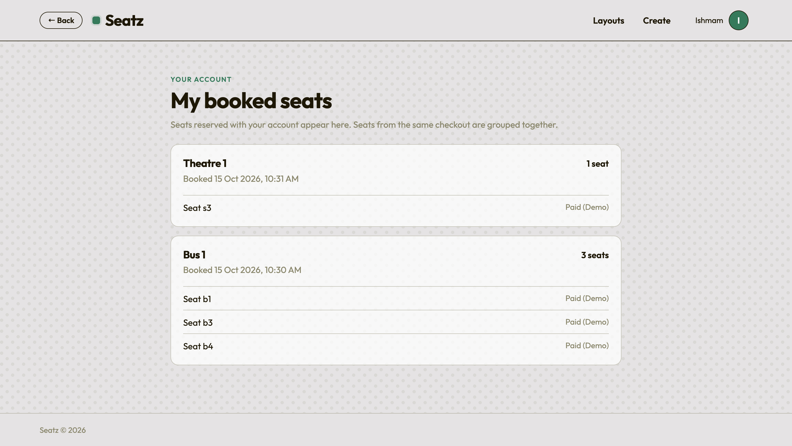
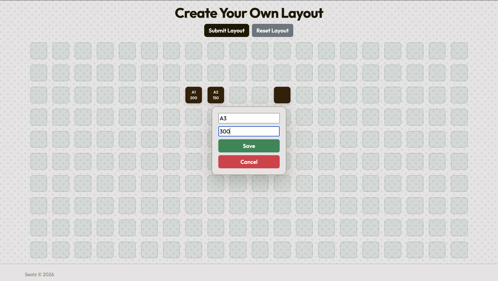
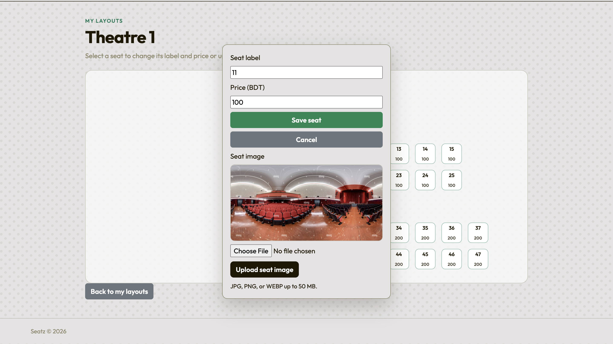

# Seatz

Seat reservation web app built with ASP.NET Core MVC. Vendors create and edit seat layouts. Customers browse layouts, pick seats, and complete a demo checkout.


**Live demo:** https://seatz-h5ena4f4fxdrfwen.indiasouthcentral-01.azurewebsites.net/



## Contents

- [Features](#features)
- [Screenshots](#screenshots)
- [Tech stack](#tech-stack)
- [Architecture](#architecture)
- [Run locally](#run-locally)
- [Database requirements](#database-requirements)
- [Demo payment](#demo-payment)
- [Design decisions](#design-decisions)
- [Known limitations](#known-limitations)

## Features

**Customers**
- Browse layouts as cards showing seat count and a mini seat map with availability
- Seat map shows available, selected, and booked seats, with per-seat prices and a running total in BDT
- Click a seat to open a side panel with its 360 degree image, an "Explore 360" full view, and an unselect button. Seats with a 360 preview are badged on the map
- Review page with booking summary and total before checkout
- Book with an account or as a guest. Sign-in is optional
- Guest checkout collects name and email
- View your bookings, with seats from the same checkout grouped together

**Vendors**
- Create layouts by clicking cells on a grid, setting a label and price for each seat
- Edit existing layouts: change seat labels and prices
- Upload a seat image per seat (JPG, PNG, or WEBP up to 50 MB)

**Other**
- Passwords hashed with BCrypt. Minimum six characters, one number, one special character
- Neon warm-up page checks database availability before opening the app

## Screenshots

**Seat selection**



| Seat panel with 360 degree preview | Full 360 degree view |
|:---:|:---:|
|  |  |

| Checkout | My bookings |
|:---:|:---:|
|  |  |

| Create a layout | Edit a seat and upload an image |
|:---:|:---:|
|  |  |

## Tech stack

| Area | Technology |
|---|---|
| Framework | .NET 10, ASP.NET Core MVC |
| Data access | Entity Framework Core |
| Database | PostgreSQL on Neon |
| 360 degree previews | Pannellum 2.5.6 |
| Password hashing | BCrypt.Net-Next |
| Frontend | Razor, HTML, CSS, JavaScript |

## Architecture

The app is split into three layers. A request flows from the controller, through the business logic, down to the database.

```
Controller (AppLayerMVC)  ->  Service (BLL)  ->  Repo (DAL)  ->  PostgreSQL
```

| Layer | Project | Responsibility |
|---|---|---|
| Presentation | `AppLayerMVC` | Controllers, Razor views, routing, cookie authentication |
| Business logic | `BLL` | Services, view models, validation rules, password hashing |
| Data access | `DAL` | EF Core context, entities, repositories |

## Run locally

Requires the .NET 10 SDK and a PostgreSQL database with the Seatz schema.

Set the connection string as a user secret (keeps credentials out of source control):

```bash
dotnet user-secrets set "ConnectionStrings:DbConn" "Host=YOUR_HOST;Database=YOUR_DATABASE;Username=YOUR_USERNAME;Password=YOUR_PASSWORD;SSL Mode=Require" --project AppLayerMVC/AppLayerMVC.csproj
```

Start the app:

```bash
dotnet run --project AppLayerMVC/AppLayerMVC.csproj
```

The root URL opens the warm-up page. Layouts are at `/Select/Index`.

## Database requirements

The `bookings` table must support guest and grouped bookings:

| Column | Notes |
|---|---|
| `user_id` | Nullable. The foreign key must allow null |
| `guest_name` | Guest checkout name |
| `guest_email` | Guest checkout email |
| `payment_status` | Result of the demo payment |
| `booking_group_id` | Groups seats from the same checkout |

`bookings.seat_id` must also have a unique index. The app relies on it to prevent double-booking (see [Design decisions](#design-decisions)).

## Demo payment

Checkout is for demonstration only. No payment provider, no real transactions.

- Simulated success: seat bookings are recorded
- Simulated failure: seats stay unbooked

## Design decisions

### Preventing double-booking

Two customers can click the same seat at the same moment, so the app does not rely on checking availability first. The database enforces it.

- `bookings.seat_id` has a unique index, so Postgres rejects a second booking for a seat that is already taken.
- `BookingRepo.CreateBookingsAsync` catches that specific unique-violation error and returns `false`. The checkout page then shows "A selected seat was just booked by someone else. Please choose again."
- All seats in one checkout are saved in a single `SaveChanges` call, which is one transaction. Either every seat is booked or none are, so a failed checkout never leaves a partial booking.
- The availability check on seat click and at checkout is only for a friendlier experience. Two requests can pass it at the same time, so the unique index is the real guard.

### Prices come from the server

At checkout, seat prices are read from the layout in the database, not from the browser. A customer cannot change the total by editing the page.

### Guest checkout

`bookings.user_id` is nullable, and guest bookings store a name and email instead. Seats from one checkout share a `booking_group_id`, so they can be shown together.

### Neon warm-up page

The database is on a free tier that sleeps when idle. The root URL opens a page that does not touch the database, then polls a lightweight `SELECT 1` endpoint until the database responds. This avoids a long blank page or a 500 error on the first visit.

## Known limitations

- **No cancellations yet.** If a cancellation flow is added, cancelled bookings would need to be deleted, or the unique index changed to a partial index that only covers active bookings.
- **Seat images are stored on the app server's disk.** Moving uploads to blob storage is the next step.
- **Prices are stored as `float`.** Money should be `decimal`; this is a planned change.
- **Payment is simulated.** There is no payment provider.
